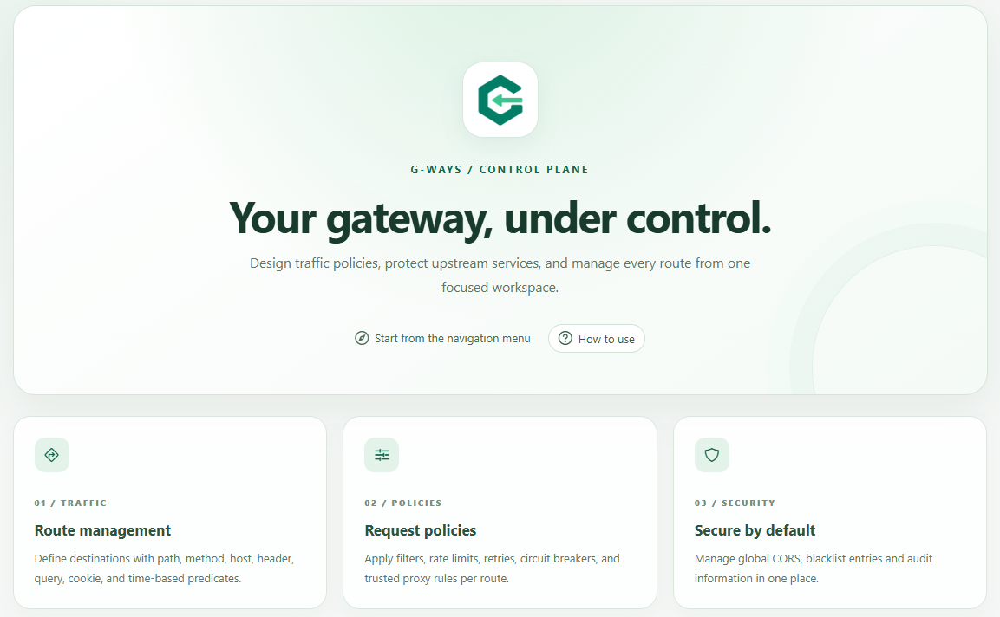
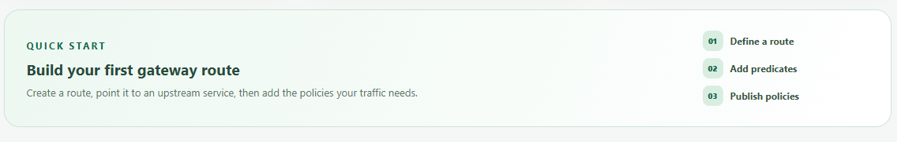

# G-Ways — Dynamic API Gateway

A database-driven API gateway built with Spring Boot and Spring Cloud Gateway Server Web MVC, with a web administration panel for managing routes and traffic policies online.

## Preview

The control plane brings route management, traffic policies, and network controls into one workspace.



The quick-start guide outlines the workflow for creating a route, adding predicates, and publishing policies.



## Features

- **Configurable routing:** persist destinations, route priorities, enabled status, and request predicates in SQL Server.
- **Runtime refresh:** changes saved through the route and policy administration services rebuild the active routes after the database transaction commits.
- **Rate limiting:** apply per-client-IP limits using Bucket4j and Caffeine.
- **Retry and circuit breakers:** configure retry conditions and circuit breaker policies, including supported fallback behavior.
- **Request and response filters:** configure supported header and request-processing filters.
- **Request correlation:** preserve a supplied `X-Request-ID` or generate one before forwarding requests.
- **Network controls:** manage trusted proxies, IP blacklist entries, and CORS settings.
- **Administration panel:** manage configuration and users through a Jakarta Faces / PrimeFaces interface protected by Spring Security form login.
- **Backend reachability checks:** inspect TCP connectivity to route destinations from the administration interface.

## Architecture

```text
Management UI (Jakarta Faces / PrimeFaces)
                  |
          Administration services
                  |
                  DB
                  |
        Runtime configuration / Registry
                  |
Client --> Gateway routes and filters --> Backend services
```

Enabled routes are loaded in ascending route order. The registry selects the first matching route; enabled predicates within a route are combined with AND. Each route forwards to its configured destination URI.

Administration services refresh the affected runtime state after successful configuration changes. Direct database edits do not automatically trigger this refresh. Runtime state is local to each application instance; cross-instance configuration synchronization is not implemented.

## Technology stack

| Component | Technology |
| --- | --- |
| Java | JDK 25 |
| Application | Spring Boot 4.1.1 |
| Gateway | Spring Cloud Gateway Server Web MVC; Spring Cloud BOM 2025.1.3 |
| Persistence | Spring Data JPA / Hibernate |
| Administration UI | Jakarta Faces, PrimeFaces, JoinFaces 6.1.0 |
| Authentication | Spring Security, BCrypt password encoding |
| Traffic policies | Bucket4j 8.16.0, Caffeine, Spring Cloud Circuit Breaker / Resilience4j |
| Build | Maven Wrapper |

Dependency declarations are maintained in [pom.xml](pom.xml).

## Getting started

### 1. Prepare the environment

Install JDK 25 and make sure `JAVA_HOME` points to it. The included Maven Wrapper downloads Maven and dependencies on first use, so network access is required.

Clone this repository using its actual clone URL, then open a terminal in the directory containing `pom.xml` and `mvnw`.

### 2. Create the database

Run this in DB using an account allowed to create databases:

```sql
CREATE DATABASE GWAYS;
```

Provide a SQL login mapped to this database with permissions to create and alter the application schema and read/write application data.

On startup, Spring SQL initialization executes [V1__create_gateway_schema.sql](src/main/resources/db/migration/V1__create_gateway_schema.sql). Hibernate then validates the schema (`ddl-auto: validate`). Despite its directory name, this script is run by Spring SQL initialization, not Flyway.

### 3. Configure the connection

Set these variables in the same terminal used to start the application.

**Bash (Linux / macOS):**

```bash
export DB_URL='jdbc:sqlserver://localhost:1433;databaseName=GWAYS;encrypt=true;trustServerCertificate=true'
export DB_USERNAME='your_database_user'
export DB_PASSWORD='your_database_password'
```

**PowerShell (Windows):**

```powershell
$env:DB_URL = 'jdbc:sqlserver://localhost:1433;databaseName=GWAYS;encrypt=true;trustServerCertificate=true'
$env:DB_USERNAME = 'your_database_user'
$env:DB_PASSWORD = 'your_database_password'
```

These names match [application.yaml](src/main/resources/application.yaml). The sample connection trusts the server certificate for local development; use a trusted certificate and certificate validation for production.

### 4. Build and run

**Linux / macOS:**

```bash
./mvnw clean package
./mvnw spring-boot:run
```

**Windows PowerShell:**

```powershell
.\mvnw.cmd clean package
.\mvnw.cmd spring-boot:run
```

The default port is **8080**. Override it by setting `SERVER_PORT` if needed.

## Try a route

Start an HTTP backend on `http://localhost:9000` that serves `GET /api/orders/123`, then open the Routes page in the panel and create:

| Setting | Example |
| --- | --- |
| Route ID | `orders` |
| Destination URI | `http://localhost:9000` |
| Route order | `0` |
| Enabled | `true` |
| Enabled predicate | Path matching `/api/orders/**` |

Save the route, then call the gateway:

```bash
curl -i http://localhost:8081/api/orders/123
```


Use the Rate Limits page to associate an enabled policy with this route, for example a capacity of 2 and a period of 60 seconds. Requests that exceed the available limit return HTTP `429`. Retry and circuit breaker policies can be managed from their respective panel pages.

## Current limitations

- Each route has one destination URI; configurable load balancing across backend instances is a future enhancement.
- Backend checks establish TCP connectivity. They do not verify application health or select a backend for routing.
- Rate-limit state uses local memory and is not shared across gateway instances.
- Configuration refresh applies to the instance handling the administration change. Direct SQL updates require an explicit refresh or restart to update cached routing state.

- ## Contribute

Contributions are so welcome!

If you find a bug, have a feature request, or want to improve the project, feel free to open an issue or please submit a pull request XD
